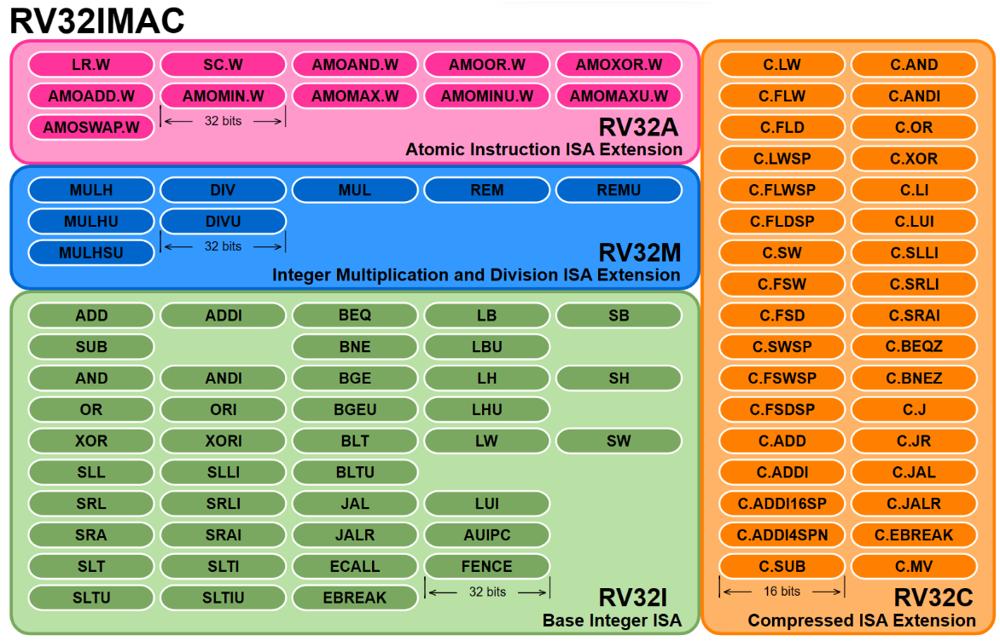
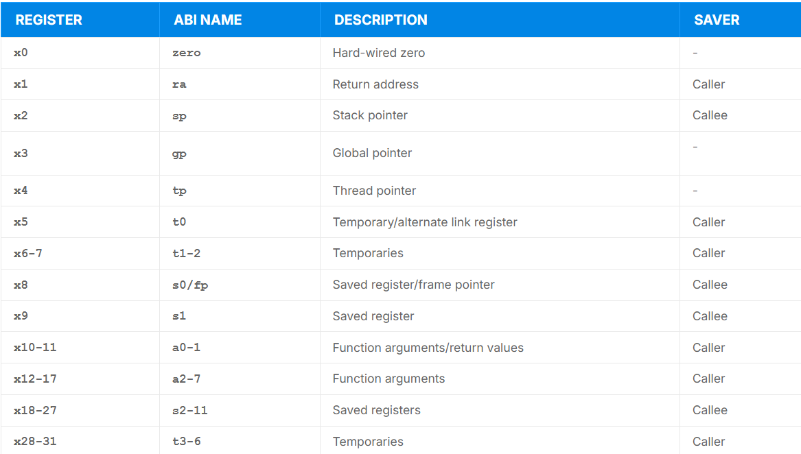
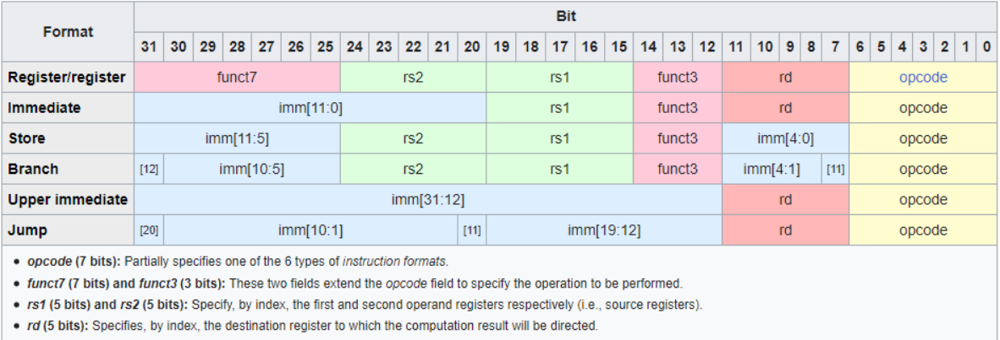
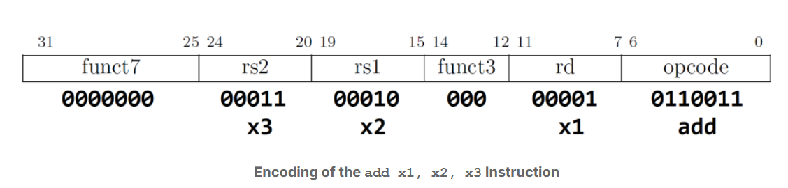

# RISC-V 
Used for Instruction Set Architechture(ISA), it is a open source ISA, RISC-V Base Integer ISA was released in 2010 and has only 40 instructions.

## Naming convention for custom RISC-V ISA
consists of the letters RV (for RISC-V) followed by the bit-width, and then a series of 1-letter identifiers for the base ISA and its extensions.
RV32IMAC means:
- <b>RV32I</b>: A 32-bit CPU with the Base Integer ISA. This includes the absolutely necessary instructions for basic operation.
- <b>M</b>: The Integer Multiplication and Division extension.
- <b>A</b>: The Atomic Instruction extension.
- <b>C</b>: The Compressed Instruction extension. This extension provides an alternative 16-bit encoding for a special subset of existing RV321 instructions, which are encoded in 32 bits.


## Organizing the specification
The RISC-V ISA is broken up into two parts:
- <b>Volume 1</b>, Unprivileged Specification
- <b>Volume 2</b>, Privileged Specification

unlike the x86 architechture where we have 4 ring, ring 0 kernel, ring 1 and 2 device drivers, ring 3 for application
<b>RISC-V has three privilege levels: User Mode (U-mode), Supervisor Mode (S-mode), and Machine Mode (M-mode). One can think of these as “Ring 2”, “Ring 1”, and “Ring 0” respectively. Other modes like a hypervisor mode (H-Mode) are available as variations of these 3 basic modes.</b>
U-mode is for user processes, S-mode is for kernel and/or device drivers, and M-mode is used for bootloader and/or firmware. Each privilege level has access to specific Control and Status Registers (CSRs), which are special registers that report the state of the system, or control its behavior. Higher privilege levels can access the CSRs of less privileged levels.

## Unprivlaged Specification 
Items that are not related to M-mode and S-mode, these are the set of instruction, registers and memory bheaviour that application software and user lvl program can use directly.

The unprivileged specification includes the base Integer (I) ISA as well as extensions to that base, like float (F), double (D), compressed instructions (C), and many more.

### RV32I Base Integer ISA


### Control and Status Register(CSRs)
These are seprate bank of registers with seprate 12-bit space, limiting there number to 4096. These are usually used for system funstions like timer, counter, flags etc. for a precise controll over the process bheaviour and enable efficient stystem program. 

some of the most imp CRS:
- <b>mstatus (Machine Status Register)</b>: This CSR is arguably the most critical one as it controls and monitors the machine's operating mode and privilege level. It contains fields for controlling interrupt enable/disable status, setting the privilege level (M-mode, S-mode, U-mode), and various flags that influence the processor's behavior. It is fundamental for privilege level transitions and interrupt management.
- <b>mepc (Machine Exception Program Counter)</b>: Stores the program counter value of the instruction that caused an exception or interrupt in machine mode. It determines where the program should resume execution after handling the exception.
- <b>mtvec (Machine Trap-Vector Base Address)</b>: Specifies the base address of the trap handler for machine mode, determining where the processor should jump to when an exception occurs.
- <b>mcause (Machine Cause Register)</b>: This CSR provides information about the reason for the most recent exception or interrupt. It distinguishes between exceptions and interrupts and gives a code indicating the specific cause, such as a page fault or a software interrupt.
- <b>misa (Machine ISA Register)</b>: Specifies the supported instruction set extensions for the processor, allowing software to determine the capabilities of the RISC-V processor. It also encodes the bit width of the base ISA (RV32, RV64, or RV128).

### ISA Extensions
The unprivileged specification also contains the descriptions of the extensions to these base ISA’s.
Each extension to the base ISA is developed and maintained by a task group:
- <b>Crypto</b>: Task group working on cryptographic extensions which can move many complex cryptographic algorithms into hardware, improving reliability and speed.
- <b>B Extension</b>: Task group working on bit manipulation extensions which can speed up many common mathematical tasks.
- Task group working on vector instructions which are at the heart of many graphical processing computations.
- <b>M Extension</b>: Used for multiplication, The RV32M extension implements 8 instructions to perform multiplication and division on integers (RV64M adds 5 instructions to those 8).
- <b>F Extension</b>: It adds support for single-precision floating-point arithmetic operations. Single-precision floating-point numbers are typically represented using 32 bits. This extension introduces single-precision floating-point registers (f0 to f31) and a set of single-precision floating-point instructions for operations such as addition, subtraction, multiplication, division, and conversions between integer and single-precision floating-point values. The F extension also includes instructions for handling special values, like NaN (Not-a-Number) and infinities, and for comparing and rounding single-precision values.
- <b>D Extension</b>: It extends the floating-point capabilities of RISC-V to include double-precision floating-point arithmetic operations. Double-precision numbers use 64 bits for representation. With the D extension, double-precision floating-point registers f0 to f31 are now 64-bit wide, and it supports instructions for double-precision arithmetic operations, conversions between integer and double-precision values, and handling special values.
- <b>C Extension</b>: The compressed instruction set extension is a clever addition to the RISC-V ISA, which provides an alternative 16-bit encoding for a special subset of existing instructions, reducing static and dynamic code size.
- <b>The A extension</b>: for Atomic Memory Operations
- <b>The Q extension</b>: for quad-precision floating-point operation, introducing 128-bit wide floating point registers
- <b>The B extension</b>: for bit manipulation
- <b>The S extension</b>: for supervisor operation
- <b>The H extension</b>: for hypervisor operation
- <b>The L extension</b>: for decimal floating-point operation
- <b>The P extension</b>: for Packed-SIMD instructions
- <b>The V extension</b>: for vector operations
- <b>The Zicsr extension</b>: for manipulating CSR registers
- <b>The Zifencei extension</b>: for instruction memory synchronization

### Instruction Encoding
The RV32I ISA specifies the following elements:
- 1 32-bit wide Program Counter Register
- 32 32-bit wide Registers named x0 to x31
- 40 Unique 32-bit wide unprivileged Instructions in six different formats (R, I, S, B, U, J) but with some recurring fields: 
- 24 additional unique 32-bit wide privileged instructions in two formats (R and I)

Instruction encoding:
- <b>R-Type</b>: used for operations that involve two source registers and one destination register. They typically include arithmetic and logic operations, such as addition, subtraction, bitwise operations, and comparisons.
- <b>I-Type</b>: used for operations that involve an immediate value (a constant) and a source register. Common I-Type instructions include load operations as well as arithmetic operations with immediate values (e.g., addi for "add immediate").
- <b>S-Type</b>: Instructions are a subset of I-Type instructions specifically used for storing data into memory. They involve a source register, an immediate offset, and a base address register to specify the memory location where the data is to be stored.
- <b>B-Type</b>: Instructions are used for conditional branching operations. They compare two registers and, based on the result, determine whether to take a branch instruction or not. Common B-Type instructions include beq (branch if equal) and bne (branch if not equal).
- <b>U-Type</b>: used for setting the upper bits of a register to a constant value, which is often used for initializing pointers or addresses. The U-Type instructions include lui (load upper immediate) and auipc (add upper immediate to PC).
- <b>J-Type</b>: used for unconditional jump operations. The jump instruction transfers control to a specified target address, like the jal (jump and link) instruction used for subroutine calls.

## RISC-V Instruction set
### Imidiates and addresses
Other than opcodes and registers, any instruction encoding other than R-Type may contain immediates, that is a piece of data encoded directly in the instruction, rather than in memory or in a register. This data can represent either constants, to be used for example in arithmetic operations, or as memory addresses or offsets.

Different handling of immediates is the exact characteristic that defines the instruction types, but all of them tend to encode the immediates in similar positions in order to simplify the implementation of the hardware immediate decoder. All immediates decode to 32-bit wide values, but encoding varies by instruction.

simply(a constant numerical value that is directly embedded into the machine code instruction itself, rather than being loaded from a register or a memory location)

### Instruction in assembly language
Instruction mnemonics are used in RISC-V assembly language to represent specific instructions in a more human-readable form. A mnemonic is a short string of letters that represents a specific instruction. 

For example, in the instruction "add x1, x2, x3", "add" is the mnemonic that represents the add instruction. Functionally, that instruction means “add the contents of x2 with the contents of x3, and store the result in x1”.

When an assembler encounters a mnemonic in the source code, it will use that mnemonic to translate the instruction into the corresponding machine code representation of the instruction, along with the encoding of the operands.

For example, the instruction "add x1, x2, x3" is translated by the assembler into the machine code instruction 0x003100B3. This long hexadecimal number can be extended to binary as follows:

0000 0000 0011 0001 0000 0000 1011 0011

Which in turn can be separated as an R-Type instruction with the following fields:


### A Few Peculiar RISC-V Design Decisions
- RISC-V does not have dedicated condition code registers, as seen in many other architectures. Instead, it relies on branch instructions to evaluate conditions directly using the contents of general-purpose registers.
- In RISC-V, register x0 is hardwired to always contain the value 0 and cannot be written to. This design choice simplifies the hardware and eliminates the need to allocate a separate opcode for instructions that perform operations with the constant 0.
- There is no way to specify a 32-bit immediate in a single instruction
Instead, RISC-V uses a sequence of 2 instructions to specify a full 32-bit immediate value. For example, lui is used to set the upper bits of a register, and addi can be used to set the lower bits, like this: lui x1, 0x12345 sets the upper bits of x1, and then addi x1, x1, 0x678 sets the lower bits, resulting in the 32-bit immediate value 0x12345678 in x1.
- Instead, multiplication and division are implemented using regular arithmetic and logical instructions, potentially impacting performance. However, this decision favors low end embedded microcontrollers, which may not even need multiplication or division. After all, for processors intended to run applications that might require multiplication or division, the RVM extension can always be included.
- There are lots of basic instructions missing
These include unconditional jump and branch, no operation, register move, two’s complement, and bitwise not. It turns out that these operations are considered redundant, as they are special cases of existing instructions in the ISA. Remember: One of the key principles of RISC is a small instruction set.
- RISC-V itself does not specify a predefined stack pointer register. While most architectures like x86, MIPS, and ARM include a dedicated stack pointer register, the choice of which register to use as the stack pointer in RISC-V is determined by the ABI (Application Binary Interface). 
- RISC-V does not include dedicated push and pop instructions commonly found in most architectures for managing a stack.
- This is very similar to the previous features above: Subroutine call and return instructions are available as pseudoinstructions, which are performed by jump-and-link instructions.

## The Privileged Specification
The unprivileged instruction set architecture presented so far is not enough to run modern execution environments. As its name suggests, the privileged specification contains descriptions of the RISC-V ISA which operate in Machine Mode (M-mode) or Supervisor Mode (S-mode). These modes have elevated privileges and are therefore described in a completely separate document from the base ISA and standard extensions. 

### Machine-Level (M-Mode) ISA
This chapter describes the machine-level features available in machine-mode (M-mode). M-mode is used for low-level access to a hardware platform and is the first mode entered at reset, when the processor finishes initializing and is ready to execute code. M-mode can also be used to implement features that are too difficult or expensive to implement in hardware directly. A good example of this would be a watchdog timer implemented in low level software (firmware) which helps the system recover from faults. 

Features of M-Mode:
- Non-maskable interrupts (NMIs) are only used for hardware error conditions. When fired, they cause an immediate jump to an NMI handler running in M-mode, regardless of how that hardware thread has its interrupt-enable bit set. In other words, that interrupt will be serviced without a way to block the service in configuration. Each NMI will have a “mcause” register associated with it. This allows implementations to decide how they wish to handle these interrupts and allows them to define many possible causes. NMIs do not reset processor state which enables diagnosis, reporting, and possible containment of the hardware error
- The physical memory map for a system includes address ranges like memory regions, memory-mapped control registers, and empty holes in the address space. Some memory regions might not support reads, writes, or execution; some might not support subword or subblock accesses; some might not support atomic operations; and some might not support cache coherence or might have different memory models. In RISC-V systems, these properties and capabilities of each region of the machine’s physical address space are termed physical memory attributes (PMAs).
- A common feature of most modern processors is some way of performing secure remote computation or a “trusted execution environment”. Examples of this technology include Intel Software Guard Extensions (SGX), AMD Secure Encrypted Virtualization (SEV), and Arm TrustZone. While the RISC-V ISA does not provide an end-to-end solution for Trusted Execution Environments, the Physical Memory Protection (PMP) capabilities are a solid foundation on which one might construct such a system. RISC-V PMP limits the physical addresses accessible by software running on a hart (hardware thread). An optional PMP unit provides per-hart machine-mode control registers to allow physical memory access privileges (read, write, execute) to be specified for each physical memory region.

### Supervisor-Level (S-Mode) ISA
Supervisor-Level (S-Mode) ISA, Version 1.12
This chapter describes the RISC-V supervisor-level architecture, which contains a common core that is used with various supervisor-level address translation and protection schemes. Supervisor mode is deliberately restricted in terms of interactions with underlying physical hardware, such as physical memory and device interrupts, to support clean virtualization. In this spirit, certain supervisor-level facilities, including requests for timer and inter-processor interrupts, are provided by implementation-specific mechanisms. In some systems, a supervisor execution environment (SEE) provides these facilities in a manner specified by a supervisor binary interface (SBI). Other systems supply these facilities directly, through some other implementation-defined mechanism.

RISC-V supports Page-Based 32-bit, 39-bit, and 48-bit virtual memory addressing. The supervisor (S-Mode) memory-management fence instruction (SFENCE.VMA) is used to synchronize updates to in-memory memory-management data structures with current execution. Executing this instruction guarantees that any previous stores already visible to the current RISC-V hart (hardware thread) are ordered before all subsequent implicit references from that hart to the memory-management data structures.

## Hands on RISC-V assembly language
The RISC-V assembly language has a number of features that go hand in hand with the features of the RISC-V ISA. Among other features, we have the following:
- The language was designed with simplicity in mind.
- In general, binary operations like addition, AND, XOR, multiplication, and so on, specify 3 operands: 2 source registers with read access, and 1 result register with write access.
- Support of pseudoinstructions to ease the task of writing assembly code.
- Direct translation between assembly language and machine language.

An assembler is used to convert assembly code into machine code 
RISC-V language elements:
- <b>Instructions</b>: A set of basic operations, such as arithmetic, load/store, and control flow, that are executed by the processor. In general, instructions consist of a mnemonic (a short but descriptive instruction name) and a series of operands (the registers or data to operate upon).
- <b>Registers</b>: A set of basic operations, such as arithmetic, load/store, and control flow, that are executed by the processor. In general, instructions consist of a mnemonic (a short but descriptive instruction name) and a series of operands (the registers or data to operate upon).
- <b>Labels</b>: Symbolic names for memory locations that can be used as targets for branch and jump instructions.
- <b>Directives</b>: Special commands used to control the behavior of the assembler, such as setting memory regions or defining constants.
- <b>Macros</b>: User-defined sequences of instructions that can be invoked with a single macro call.
- <b>Pseudoinstructions</b>: Synthetic instructions that are translated by the assembler into one or more real instructions, allowing for a higher-level, more concise representation of the code.

```asm
  .text                     # Directive: enter text section(memory region)
  .align 2                  # Directive: align code to 2^2 bytes(in RISC-V 32 the instructions are 4 byte so we set the instruction adress to be 2^2=4 byte)
  .globl main               # Directive: declare global symbol main(set the entry point of the program)

main:                       # label for start of main
  addi sp,sp,-16            # allocate stack frame(sp point to x2 then subracted by 16, stack should be 16 byte is the standard)
  sw ra,12(sp)              # save return address(ra is x1 adress to return after main finishes, it is imp to save as the call of other function will overwrite ra, 12(sp) means adress be sp+12), (store word)
  lui a0,%hi(string1)       # compute address of
  addi a0,a0,%lo(string1)   # string1
  # lui will load the upper 20byte into a0, addi will store the lower 12 bits to a0
  lui a1,%hi(string2)       # compute address of
  addi a1,a1,%lo(string2)   # string2
  # lui load uppar 20 byte of the string 2 to a1 then addi store lower 12 byte to a1
  # done in 2 parts as we cant load 32 byte simultaneously instead we do it in two turn of 16/20 byte each
  call printf               # pseudoinstruction to call function printf
  lw ra,12(sp)              # restore return address restore the orignal adress to go back to the main function back into ra after the call of the function, (load word)
  addi sp,sp,16             # deallocate stack frame
  li a0,0                   # load return value 0(same as addi a0, x0, 0)
  ret                       # return (jump and link register)

  .section .rodata          # Directive: enter read-only data section
  .balign 4                 # Directive: align data section to 4 bytes(unlike align wich follow power of 2, balign take direct byte order)

string1:                    # label for first string
  .string "Hello, %s!\n"    # Directive: null-terminated string

string2:                    # label for second string
  .string "world"           # Directive: null-terminated string
```

